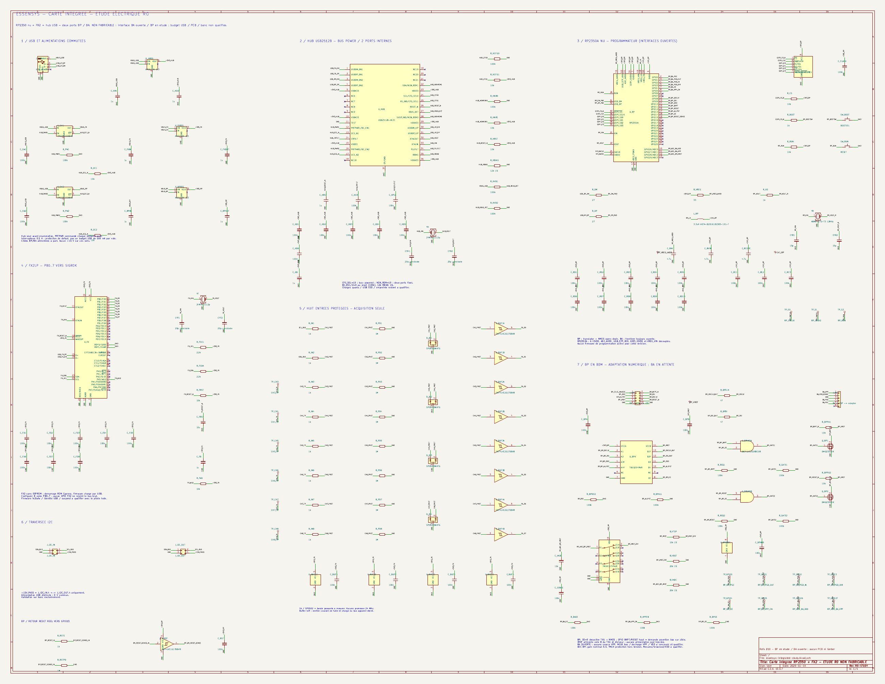
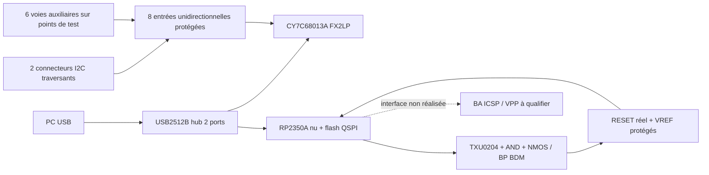

# Carte intégrée — étude électrique R0

**État : NON FABRICABLE.** Le schéma KiCad connecte un RP2350A nu, un analyseur
FX2LP huit voies, un hub USB interne et l'adaptation numérique BP. L'interface
analogique BA reste ouverte. Aucun PCB, Gerber, CPL ni commande de composants
n'est produit. Le contrat machine conserve `hardware_qualified: false`.

Cette étude réalise la nouvelle architecture du ticket #10. Elle ne remplace pas
silencieusement les études précédentes dans `../pico2/`. Les composants de
`bom-candidates.csv` sont des candidats, sans références LCSC vérifiées ; les
empreintes renseignées doivent encore être revues avant placement.

## Voir le schéma KiCad

[Ouvrir le PDF vectoriel pour zoomer](essensys-integrated-study.pdf) ou
[le projet KiCad 10](essensys-integrated-study.kicad_pro), avec le
[schéma éditable](essensys-integrated-study.kicad_sch) et les bibliothèques de
ce dossier. L'aperçu ci-dessous est exporté du PDF KiCad, sans modification
des connexions ; l'interface BA/VPP encore ouverte est signalée sur le dessin.



## Architecture et fichiers



- `essensys-integrated-study.kicad_sch` et `.pdf` : schéma électrique généré.
- `gen_schematic.py` : source reproductible ; utilise le générateur commun KiCad.
- `Integrated.kicad_sym` : symboles USB2512B, TXU0204PWR et DMG2302UK avec
  numéros de broches contrôlés sur leurs fiches constructeur.
- `gpio-contract.json` : interface avec le firmware de diagnostic, non qualifiée.
- `expected-netlist.json` : raccordements attendus ; le vérificateur ajoute un
  contrat indépendant pour les nets critiques.
- `check_netlist.py`, `test_netlist.py` : vérification et injections de défauts.
- `check_erc.py`, `test_erc.py` : contrôle de l'ERC d'étude, distinct de la fabrication.

## Acquisition et connecteurs

Les connecteurs `J_I2C_IN` et `J_I2C_OUT` passent directement SDA (1), SCL (2),
0 V (3) et +15 V (4). Le +15 V ne rejoint aucune alimentation interne. Le 0 V
est commun avec l'USB : cette étude n'assure pas d'isolation galvanique.

CH1=SCL, CH2=SDA et CH3…CH8=points de test passent chacun par 1 kΩ,
SP0502BAHTG, puis SN74LVC2G17 alimenté par le domaine FX2. Les sorties rejoignent
PB0…PB7 du FX2. Les tampons sont unidirectionnels ; le FX2 ne peut pas conduire
le bus brut. Les résistances de 1 MΩ maintiennent les entrées inactives à zéro,
sans ajouter de pull-up au bus. La charge, les fuites à froid et la bande
passante du montage restent à mesurer. **24 MHz n'est pas une performance
validée de cette chaîne protégée.**

Le FX2 démarre sans EEPROM, avec l'identité ROM Cypress ; le firmware de capture
se charge par USB. `fx2lafw` utilise PB0…PB7 ; sa configuration hôte doit limiter
la capture à huit voies. Le profil Cypress générique peut annoncer seize voies.
L'identité USB finale, les licences de redistribution, le démarrage à travers le
hub et le suspend doivent être validés. Ne pas reprendre le VID/PID d'un autre
produit pour faire reconnaître la carte.

La compatibilité mécanique **Sourcingmap FC14P 14 broches / nappe 100 cm** reste
un critère de la future carte. R0 ne fixe pas une fausse équivalence entre cette
nappe et les connecteurs cibles. Les prises représentées ici sont des contrats
électriques ; empreintes, détrompeurs, orientation pin 1, adaptation FC14P,
continuité des nappes et câblage BP/BA seront vérifiés ensemble. Aucun adaptateur
direct vers le connecteur 2×5 de l'ancien analyseur n'est implicite.

## Port BP : BDM, commande et lecture distinctes

Le port BP suit J33 du SC944D : il s'agit du BDM ColdFire, pas du JTAG du RP2350.
Les documents de référence du dépôt établissent le brochage suivant.

| J_BP | Signal cible | Circuit R0 |
|---|---|---|
| 1 | TCLK | Non utilisé, avertissement ERC conservé |
| 2 | BKPT actif bas | Drain NMOS ; demande GPIO11 active haute |
| 3 | DSO | TXU0204 B→A, entrée GPIO10 |
| 4 | DSI | GPIO9, TXU0204 A→B et 47 Ω |
| 5 | ALLPST | TXU0204 B→A, entrée GPIO13 |
| 6 | DSCLK | GPIO8, TXU0204 A→B et 47 Ω |
| 7 | VREF cible 3,3 V | Alimentation B du TXU et mesure protégée |
| 8 | RESET actif bas | Drain NMOS commandé GPIO12 **et lecture indépendante GPIO15** |
| 9–10 | 0 V | Masse commune |

TXU0204 : VCCA=3V3_RP, VCCB=BP_VREF. La cible fournit donc le faible courant
du côté B ; aucune source 3,3 V du pod n'est reliée à VREF. Le constructeur
spécifie l'isolation lorsque l'une des alimentations est absente. Les fronts
et les seuils pendant les rampes restent à qualifier.

GPIO14=`BP_OE` active le TXU et les deux portes AND. À zéro, les sorties BDM sont
à haute impédance et les grilles NMOS sont basses. Les résistances de 100 kΩ
sur OE, requêtes et grilles définissent le repos avant démarrage du firmware.
**GPIO11 ou GPIO12 haut + OE haut = assertion basse sur la cible**. Ces GPIO
sont des commandes logiques actives hautes, pas des broches open-drain RP à
piloter directement. Le drain est réalisé par DMG2302UK, dont la résistance est
spécifiée à VGS=2,5 V. Les pull-ups de drain de 10 kΩ vont uniquement à VREF.

Le retour réel de RESET utilise 1 kΩ, un SN74LVC1G17DBVR avec entrée Schmitt et
`Ioff`, puis GPIO15. Son alimentation est 3V3_RP et la résistance d'entrée vers
la masse vaut 1 MΩ. Pinout DBV : NC1/A2/GND3/Y4/VCC5. Il est non inverseur :
GPIO15 haut signifie reset relâché. Le buffer accepte une cible alimentée quand
le pod est éteint dans les limites de sa fiche ; les fuites ne sont pas nulles.
Absence de cible : le chemin 10 kΩ du pull-up de RESET suivi du diviseur VREF
ajoute environ 30 kΩ vers GND lorsque le pod est alimenté, en parallèle avec
1 MΩ ; ±5 µA d'entrée correspond à environ 0,15 V. La protection ESD externe
et les transitoires restent à qualifier. Un futur HAL devra mémoriser les
impulsions de reset externes, par exemple via IRQ, pour invalider une session
même si le pulse se termine entre deux contrôles logiciels.

### Mesure BP_VREF

Le diviseur est : VREF → 10 kΩ → nœud → 20 kΩ → GND ; le nœud traverse un
TMUX1574 vers l'ADC GPIO28, avec une seconde résistance de 20 kΩ à GND et
10 nF. Quand le switch est passant, les deux résistances basses sont en
parallèle : gain nominal 0,5, charge équivalente 20 kΩ, courant 165 µA à 3,3 V.
La résistance du switch, les tolérances 1 %, les fuites et l'ADC sont à inclure
dans l'incertitude. Prévoir au moins 2 ms de stabilisation puis qualifier les
mesures lors des séquences de connexion et de défaut.

À VDD=0, le switch isole l'ADC ; le nœud source atteint 2/3 de VREF, soit
2,4 V pour une cible 3,6 V. Cela reste dans la limite de protection hors tension
de 3,6 V du TMUX. Sa fuite maximale de ±2 µA à l'état éteint dans les conditions
documentées donnerait au plus 40 mV sur la résistance ADC de 20 kΩ. Ce calcul
ne qualifie pas le comportement pendant une baisse partielle d'alimentation.
VREF est réservé à une cible 3,3 V ; aucune entrée 5 V, VPP ou +15 V n'est
autorisée ici.

## Port BA : frontière ouverte

J_BA suit l'ordre PICkit : 1 VPP/MCLR, 2 VDD sense, 3 GND, 4 PGD, 5 PGC,
6 non connecté. Les quatre nets actifs ne rejoignent aucune électronique R0.
Les GPIO0…5 et ADC26/27 sont seulement réservés sur des points de test internes.

Le futur étage doit réaliser la commutation/bidirectionnalité PGD, l'adaptation
des niveaux, les mesures protégées VDD/VPP, la génération et la décharge VPP,
et le maintien de MCLR à zéro. **Désactiver un boost ne garantit pas MCLR bas.**
Une séquence VPP-first impose une coupure matérielle VDD et la mesure VDD<0,2 V.
Avec alimentation cible externe, une entrée VDD-first n'est permise qu'avec une
configuration réelle connue compatible. Les fenêtres 4,5–5,5 V VDD, 10–12 V VPP
et le front VPP ≤1 µs du contrat PIC16F946 doivent être vérifiés sur banc avec
l'interface usine et le reset NCP803. Le moteur ICSP portable ne constitue pas
une validation électrique. Aucun flash ni lecture matérielle BA n'est activé.

## Alimentation USB : budget encore ouvert

Le hub est strapé **bus-powered**, CFG_SEL=10 ; NON_REM=10 déclare ses deux
ports fixes. Chaque sortie PRTPWR commande un TPS2051C actif haut, puis son
AP2112K-3.3 séparé. Les résistances de 100 kΩ sur PRTPWR inhibent aussi la
charge batterie au reset. Le domaine RP et le domaine FX restent éteints avant
autorisation de leur port par l'hôte.

Un port aval de ce hub USB2 bus-powered dispose de **100 mA**, même si le PC
peut fournir 500 mA au total. Le limiteur TPS2051C de 0,5 A protège un défaut ;
il ne prouve pas le respect de ce budget. Aucun bilan ci-dessous ne prouve
encore la conformité de l'assemblage.

| Domaine | Donnée constructeur / marge restant à calculer |
|---|---|
| Hub amont | USB2512B commercial : 45 mA max non configuré ; 65 mA pour un port configuré +25 mA pour le second, soit 90 mA. Ajouter régulateur, straps, reset, sense VBUS et commutateurs. |
| FX2 aval | CY7C68013A : 85 mA max dans les conditions de sa table. Reste moins de 15 mA pour les buffers en commutation, régulateur, quartz et passifs. Le firmware fx2lafw déclare 100 mA : à vérifier physiquement. |
| RP aval | RP2350, conversion cœur, QSPI, horloges, adaptation BP et futurs circuits BA : maximum total non établi. Un descripteur 100 mA et un CPU à fréquence réduite ne constituent pas une mesure. |
| Cible BP externe | TXU côté B + diviseur VREF 165 µA nominal + courants pull-up BKPT/RESET lorsqu'assertés (330 µA chacun à 3,3 V) + signaux. À qualifier avec la source VREF du BP. |

AP2112 donne 80 µA maximum à vide aux conditions d'essai de sa fiche ; les
conditions 5 V / charge / température doivent être couvertes. TPS2051C donne
90 µA maximum activé dans sa table étendue. Le hub seul semble conserver une
marge, mais cette inférence ne ferme ni les courants dynamiques ni le suspend.
Le maximum hub en suspend est 1 mA ; ajouter tous les autres consommateurs et
vérifier la limite USB applicable, y compris avec les cibles externes alimentées.

La capacité directement placée sur VBUS amont vaut 1,2 µF nominale (entrée hub
1 µF et deux entrées commutateurs 100 nF). Le constructeur du hub demande une
charge amont ≤10 µF ; il faut également contrôler le courant transitoire des
condensateurs derrière les régulateurs, la vitesse des rails et les redémarrages.
Le reset FX2 10 kΩ/10 µF est un candidat visant les 5 ms après 3 V requis ; une
simple constante RC ne prouve pas le respect des seuils avec les rampes réelles.
Le reset hub RC, les quartz 24 MHz et leurs charges restent à mesurer.

## Reproduction et contrôles

Pré-requis : Python3, KiCad10 avec bibliothèques standard et `kicad-cli` dans
PATH. Au besoin définir `KICAD10_SYMBOL_DIR` et `KICAD10_FOOTPRINT_DIR`.
Depuis la racine du dépôt :

```sh
python3 hardware/integrated/gen_schematic.py
mkdir -p /tmp/essensys-integrated-check
kicad-cli sch export netlist --format kicadxml -o /tmp/essensys-integrated-check/netlist.xml hardware/integrated/essensys-integrated-study.kicad_sch
python3 hardware/integrated/check_netlist.py /tmp/essensys-integrated-check/netlist.xml
python3 hardware/integrated/test_netlist.py /tmp/essensys-integrated-check/netlist.xml
kicad-cli sch erc --format json --severity-all -o /tmp/essensys-integrated-check/erc.json hardware/integrated/essensys-integrated-study.kicad_sch
python3 hardware/integrated/check_erc.py /tmp/essensys-integrated-check/erc.json
python3 hardware/integrated/test_erc.py /tmp/essensys-integrated-check/erc.json
kicad-cli sch export pdf -o hardware/integrated/essensys-integrated-study.pdf hardware/integrated/essensys-integrated-study.kicad_sch
# Aperçu pour le README (Poppler requis).
pdftoppm -singlefile -scale-to 2600 -png hardware/integrated/essensys-integrated-study.pdf hardware/integrated/essensys-integrated-study
```

Résultat R0 : **0 erreur ERC, 5 avertissements visibles** `isolated_pin_label`
pour BP_TCLK_UNUSED et BA_VPP/BA_VDD_SENSE/BA_PGD/BA_PGC. Le vérificateur d'étude
attend exactement ces cinq nets, sans exclusions, et refuse tout défaut nouveau
ou suppression supplémentaire. Les quatre catégories ignorées sont les valeurs
par défaut KiCad10 documentées dans le code. Archiver le rapport complet ; ne
pas le remplacer par un message « ERC 0 ».

Le contrôle netlist compare le manifeste complet et des invariants indépendants
(séparation +15 V, polarité USB, directions des buffers, OE, grilles, mesure ADC,
reset observé distinct du reset demandé et frontière BA). Dix tests injectent
des défauts ou vérifient la base. Huit tests vérifient le garde-fou ERC.

La commande suivante **doit échouer** pour cette révision :

```sh
python3 hardware/integrated/check_erc.py /tmp/essensys-integrated-check/erc.json --fabrication
```

## Étapes nécessaires avant prototype

1. Fermer l'étude BA avec le schéma/interface usine, le circuit MCLR/NCP803 et
   les mesures de rails ; ajouter la surveillance indépendante et l'arrêt sûr.
2. Fermer les budgets par port USB, suspend et inrush ; adapter alimentation ou
   architecture si les limites ne sont pas tenues.
3. Choisir les prises, adaptateurs FC14P, ESD USB/programmation, quartz exacts,
   valeurs qualifiées et références LCSC ; relire chaque empreinte.
4. Concevoir le PCB : paires USB 90 Ω différentiels selon l'empilage fabricant,
   retours de masse, placement découplages, alimentation à découpage RP2350,
   séparation VPP et signaux. ERC et DRC de fabrication à zéro, sans masquer les
   avertissements de cette étude. Produire Gerber/BOM/CPL seulement alors.
5. Banc sans armoire : alimentation limitée, contrôle hors tension, rails,
   énumération USB et suspend, absence d'injection, huit canaux comparés à
   l'analyseur existant, puis programmation sur cibles de test sauvegardées.

## Sources primaires relues

Les fiches constructeur sont des références de conception, pas des preuves de
validation de cette carte. Versions consultées le 14 novembre 2026.

- [Raspberry Pi, Hardware design with RP2350](https://pip-assets.raspberrypi.com/categories/1214-rp2350/documents/RP-008280-DS-1-hardware-design-with-rp2350.pdf?disposition=inline) : cœur à découpage, découplage, QSPI, quartz, implantation.
- [Microchip USB251xB, DS00001692E](https://ww1.microchip.com/downloads/aemDocuments/documents/UNG/ProductDocuments/DataSheets/USB251xB-xBi-Data-Sheet-DS00001692.pdf) et [checklist USB2512B](https://ww1.microchip.com/downloads/aemDocuments/documents/UNG/ProductDocuments/DesignChecklist/USB2512B-Hardware-Design-Checklist-00004539.pdf) : broches 36+EP, straps, budgets, USB et horloges.
- [Infineon CY7C68013A/14A/15A/16A](https://www.infineon.com/assets/row/public/documents/30/49/infineon-cy7c68013a-cy7c68014a-cy7c68015a-cy7c68016a-ez-usb-fx2lp-usb-microcontroller-high-speed-usb-peripheral-controller-datasheet-en.pdf) : SSOP56, reset, courant, WAKEUP actif bas et I2C de boot.
- [sigrok fx2lafw](https://github.com/sigrokproject/sigrok-firmware-fx2lafw/blob/master/fx2lafw.c), [descripteurs USB](https://github.com/sigrokproject/sigrok-firmware-fx2lafw/blob/master/include/dscr.inc) et [profils libsigrok](https://github.com/sigrokproject/libsigrok/blob/master/src/hardware/fx2lafw/api.c) : PB0…7, identité ROM, chargement et 100 mA annoncés.
- [TI TXU0204](https://www.ti.com/lit/ds/symlink/txu0204.pdf), [TMUX1574](https://www.ti.com/lit/ds/symlink/tmux1574.pdf), [SN74LVC1G17](https://www.ti.com/lit/ds/symlink/sn74lvc1g17.pdf) : sens, OE, protections hors alimentation, limites et broches.
- [TI TPS2051C](https://www.ti.com/lit/ds/symlink/tps2051c.pdf), [Diodes AP2112](https://www.diodes.com/datasheet/download/AP2112.pdf), [Diodes DMG2302UK](https://www.diodes.com/datasheet/download/DMG2302UK.pdf) : commutation, régulation et drain ouvert.

TODO(agent) : conserver ces limites et sources lors du passage à une révision
qualifiée ; ne pas transformer `hardware_qualified` en vrai à partir du seul
succès des tests logiciels ou de l'ERC d'étude.
