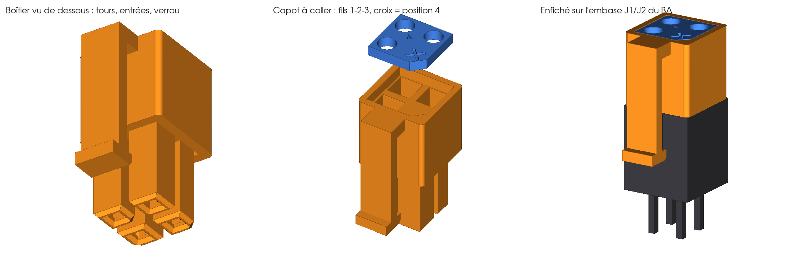

# Boîtier J1 imprimable (WR-MPC3 2×2)

Le boîtier se branche sur l'embase J1 ou J2 d'un BA (Würth 66200421122, compatible Micro-Fit 3.0) et porte trois contacts : 1 SDA, 2 SCL, 3 0 V. Il remplace le boîtier du commerce (Würth 662004113322) quand on n'en a pas sous la main.

## Position 4 (+15 V) fermée

La broche 4 de l'embase porte le +15 V. Dans le boîtier imprimé, la position 4 est **borgne** : la broche y entre pour que le boîtier s'enfiche, mais il n'y a pas de logement au-dessus. Le capot n'a pas de trou à cet endroit et porte une croix gravée. Aucun contact ne peut donc être placé en position 4, ni par l'avant ni par l'arrière.

Le brochage vient des fichiers de la carte BA (`essensys-board-SC940`, `SI940D.PcbDoc`) : pastille 1 carrée, 2 à côté de 1, 3 = `GNDBUS` sous 1, 4 = `+VBUS` en diagonale de 1, du côté de la rampe de verrouillage. Le boîtier ne peut entrer que dans un sens : chaque tour reprend le coin abattu de son logement, et le verrou se place sur la rampe.

## Fichiers

| Fichier | Contenu |
|---|---|
| `boitier-j1-wr-mpc3.step` | Boîtier : 4 tours, 3 logements de contact, position 4 borgne, verrou souple |
| `boitier-j1-wr-mpc3-capot.step` | Capot arrière à coller : 3 trous de fil (Ø 1,8 mm), croix sur la position 4, flèche vers le fil 1, coin détrompeur |
| `calibre-contacts.step` | Plaquette d'essai : logements carrés de 1,5, 1,6, 1,7 et 1,8 mm (1 à 4 points gravés) |
| `boitier-j1-wr-mpc3-assemblage.step` | Boîtier et capot enfichés sur une embase simplifiée, pour vérifier visuellement |
| `gen_boitier_j1.py` | Générateur CadQuery : cotes de l'embase, contrôles d'interférence, export STEP et vues |

Le générateur vérifie à chaque exécution :
- qu'il n'y a aucune interférence entre le boîtier ou le capot et l'embase (corps, logements, broches, rampe, nervures) ;
- que l'ergot accroche la rampe quand on tire sur le boîtier.

Les cotes de l'embase ont été relevées sur le modèle 3D de la carte SC940D. Le contrôle contre ce modèle d'origine donne aussi 0 mm³ d'interférence (option `--entete`).

## Impression

- **Résine** (MSLA ou SLA), de préférence une résine résistante (« tough » ou type ABS). Les parois des tours font 0,3 mm : une imprimante à fil avec une buse de 0,4 mm ne les rendra pas proprement.
- Boîtier posé sur sa face arrière (côté capot), les tours vers le haut : aucun support n'est nécessaire.
- Jeu latéral de 0,15 mm sur les tours. Si le boîtier force sur l'embase, augmenter `JEU` dans le générateur.

## Contacts

Le boîtier accepte des contacts femelles « Dupont » 2,54 mm, faits pour les broches carrées de 0,64 mm, comme celles de l'embase. Le plus simple est de prendre ceux des fils fournis avec l'analyseur :
1. Soulever l'ergot du petit boîtier noir avec une aiguille et sortir le contact.
2. Imprimer d'abord `calibre-contacts.step` et choisir le logement où le contact glisse sans jeu. Le boîtier est généré pour 1,70 mm. Pour une autre cote : `gen_boitier_j1.py --contact 1.6`.

Les contacts femelles à sertir WR-MPC3 ou Micro-Fit 3.0 conviennent aussi, à condition de passer le calibre.

## Montage

1. Glisser les contacts par l'arrière, ouverture vers l'avant : fil SDA en 1 (flèche), SCL en 2, 0 V en 3. Pousser jusqu'à la butée.
2. Contrôler à la loupe que la position 4 est bien fermée.
3. Passer les fils dans le capot, puis le coller (cyanoacrylate) dans son logement. Le coin abattu se place côté position 4.
4. Faire les contrôles de la documentation (« Contrôles avant la première utilisation ») avant tout branchement sur un BA.

Branchement et débranchement **hors tension**, par une personne habilitée. Pour retirer le boîtier, écarter la languette du verrou avant de tirer.
