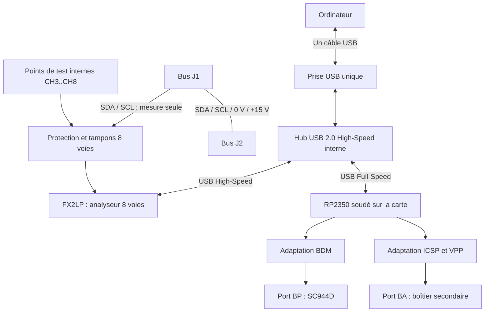

# ADR-001 : Analyseur FX2 et RP2350 sur une carte unique

**Status:** Proposed — intégration demandée par l'utilisateur ; deux ports BP/BA confirmés ; références et brochages à figer.
**Date:** 2026-11-14
**Deciders:** utilisateur Essensys et responsable de la conception électronique.

## Context

La précision utilisateur remplace l'implantation à module Pico 2 enfiché par une
carte unique intégrant la puce d'analyseur et, de préférence, le RP2350 nu. La
connectique extérieure visée est un USB vers le PC (hypothèse de conception),
deux connecteurs de traversée I2C J1/J2 et deux connecteurs de programmation
distincts : BP et boîtier secondaire (BA).
Il ne faut plus un boîtier analyseur USB séparé ni une nappe d'analyse externe.

Le terme « JTAG » ne fixe pas le protocole : les BA SC940/SC941/SC942 utilisent
l'ICSP du PIC16F946 ; le BP SC944D expose J33 en JTAG/BDM, et le dépôt
`essensys-bdm-programmer` vise le BDM pour sauvegarde/programmation. L'utilisateur
a confirmé deux prises dédiées, une par famille de cible. Les deux cibles font
partie du ticket ; le dépôt BDM existant reste un POC avec transports matériels
non implémentés, pas un programmateur déjà disponible.

## Decision

Proposition pour la prochaine révision :

- **Acquisition** : FX2LP, candidat CY7C68013A, chargé avec le firmware libre
  `fx2lafw` et exploité par sigrok/PulseView et le décodeur Essensys existant.
  La photo du boîtier « 24MHz8CH » ne prouve pas la référence exacte de sa puce.
- **Programmation** : RP2350A nu, flash QSPI, horloge, alimentations, découplages,
  accès BOOTSEL/reset et points SWD de maintenance selon le design de référence
  Raspberry Pi. Aucun module Pico empilé. Une variante à flash intégrée pourra
  être comparée lors de la sélection BOM sans modifier cette répartition.
- **USB** : hub High-Speed deux ports internes non amovibles, candidat
  USB2512B, à qualifier en alimentation par le bus USB. Les deux puces restent
  deux périphériques logiques derrière une seule prise physique. Le RP2350
  n'est pas le relais USB du FX2 : son USB Full-Speed ne transporte pas le flux
  High-Speed de l'analyseur.
- **Alimentation** : USB pour l'instrument ; +15 V uniquement en traversée
  J1/J2. Le bilan de courant, l'énumération, la consommation avant configuration,
  le séquencement des deux périphériques et la gestion des défauts restent à
  dimensionner. Ne pas déclarer le hub auto-alimenté pour contourner ces limites.
- **Huit voies** : SCL/SDA directement observées sur J1/J2 à travers les
  protections ; six voies supplémentaires proposées sur points de test internes.
  Aucun sélecteur BUS/IDC n'est requis pour ces deux voies dédiées. Le mapping
  vers les entrées du FX2 sera vérifié contre `fx2lafw` avant schéma définitif.
- **Programmation externe** : deux prises dédiées, sérigraphiées **BP / BDM**
  et **BA / ICSP**, avec deux adaptations électriques distinctes pilotées par
  le RP2350. Le port BP rejoint J33 du SC944D après vérification du mode BDM
  (JC1), du brochage et des niveaux. Le port BA rejoint les contacts ICSP des
  SC940/SC941/SC942 via l'adaptateur qualifié.
- **Sélection de cible** : une seule cible de programmation active à la fois ;
  l'autre interface reste inactive/haute impédance. VPP ne possède aucun chemin
  vers le port BP et reste coupée en mode BP, capture, reset et défaut. Les
  alimentations cibles ne sont pas reliées ensemble par les prises.
- **Nappe FC14P** : compatibilité mécanique et rôle dans les adaptateurs à
  préciser pour les deux ports. Aucun brochage acquis ; son ancien mapping
  « huit signaux + six masses » reste celui de l'analyse. Détrompage et marquage
  doivent prévenir une permutation des câbles BP/BA.

## Options Considered

| Option | Complexité | Coût à vérifier | Adéquation au besoin précisé |
| --- | --- | --- | --- |
| Module Pico 2, acquisition PIO seule | Faible à moyenne | Peu de puces, module à monter | Étude existante, remplacée comme cible finale |
| RP2350 nu, acquisition PIO seule | Moyenne | Flash/horloge/alimentation à ajouter | Intégrée, mais sans puce d'analyseur distincte demandée |
| **RP2350 + FX2LP + hub USB sur le même PCB** | Plus élevée | Trois fonctions actives et composants associés | **Proposition retenue pour l'étude intégrée** |

## Trade-off Analysis

Le FX2 permet de conserver la chaîne sigrok existante ; le RP2350 se consacre à
la programmation et aux contrôles de la cible. Le hub évite une seconde prise
USB et un pont logiciel entre deux débits USB différents. Une carte unique ne
signifie pas deux puces seulement : flash, horloges, hub, alimentations,
protections et adaptation ICSP/BDM font partie de la BOM. Le prix d'un analyseur
en boîtier ne constitue pas un devis de fabrication en petite série.

Le chiffre 24 MHz reste un objectif éventuel à mesurer ; les résistances de
1 kΩ, la capacité des SP0502, les niveaux et le routage ne sont pas validés pour
cette bande passante. Les débits annoncés du bus USB ne sont pas des garanties
de fréquence d'échantillonnage ni d'absence de pertes.

## Consequences

- `pico2-capture-draft.kicad_sch` et son PDF décrivent l'ancienne étude à module
  Pico/PIO. Leur ERC vert ne valide pas cette nouvelle carte intégrée.
- Le firmware de capture Pico et ses tests sont conservés comme prototype,
  sans être présentés comme le firmware final du programmateur RP2350.
- L'inspecteur HEX, le décodeur, le corpus et les protections d'entrée restent
  des éléments réutilisables. Le chemin d'acquisition final passe par le FX2.
- La qualification de l'interface usine, dont la constitution reste inconnue, et du chemin
  MCLR/NCP803 reste nécessaire pour les BA. Le support BP est demandé et requiert
  un protocole et une adaptation distincts ; aucune VPP ICSP sur un port BDM.
- Le schéma d'étude intégré se trouve dans `hardware/integrated/`. L'étage BA
  reste ouvert ; aucun schéma complet, PCB routé, Gerber ou résultat de banc
  n'est déclaré disponible. Les moteurs C et le diagnostic USB du programmateur
  se trouvent dans `firmware/programmer/`, sans activation matérielle.

## Action Items

1. [x] Confirmer les deux ports dédiés : BP/BDM et boîtier secondaire/ICSP.
2. [ ] Figer leurs brochages, détrompages et adaptateurs compatibles avec la nappe FC14P.
3. [ ] Sélectionner les références/boîtiers LCSC et chiffrer la BOM complète.
4. [ ] Vérifier hub, budget USB, alimentation, séquencement et configuration USB.
5. [ ] Dessiner RP2350 nu, FX2 et protections, avec mapping confirmé `fx2lafw`.
6. [ ] Qualifier les deux interfaces de programmation, puis compléter le schéma et le routage.
7. [ ] Vérifier énumération des deux périphériques, capture, lecture/écriture cible et défauts sur banc.

## Sources

- [Raspberry Pi : microcontrôleurs utilisables sur des cartes tierces et variantes RP2350](https://www.raspberrypi.com/documentation/microcontrollers/microcontroller-chips.html).
- [Guide matériel RP2350 : USB Full-Speed, mémoire et circuits associés](https://pip-assets.raspberrypi.com/categories/1214-rp2350/documents/RP-008280-DS-1-hardware-design-with-rp2350.pdf?disposition=inline).
- [Infineon : CY7C68013A/FX2LP, USB High-Speed et horloge 24 MHz](https://www.infineon.com/assets/row/public/documents/30/49/infineon-cy7c68013a-cy7c68014a-cy7c68015a-cy7c68016a-ez-usb-fx2lp-usb-microcontroller-high-speed-usb-peripheral-controller-datasheet-en.pdf).
- [sigrok : firmware libre fx2lafw](https://www.sigrok.org/wiki/Fx2lafw).
- [Microchip : USB2512B, deux ports et alimentation par bus USB](https://www.microchip.com/en-us/product/USB2512B).
- [Microchip : checklist USB2512B, straps et périphériques non amovibles](https://ww1.microchip.com/downloads/aemDocuments/documents/UNG/ProductDocuments/DesignChecklist/USB2512B-Hardware-Design-Checklist-00004539.pdf).
- `essensys-bdm-programmer/README.md` et `docs/R1-research-notes.md` : J33 et rôle BDM du SC944D.
