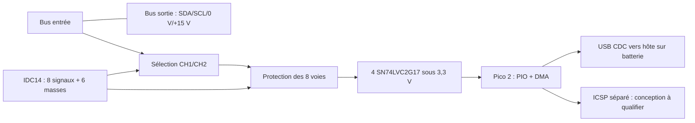

# Carte intégrée : analyse huit voies et programmation

Feature `i2c-ba-sniffer-2026-10-009`, [ticket #10](https://github.com/essensys-hub/essensys-i2c-ba-sniffer/issues/10).

**État : conception en cours, aucun prototype validé, aucun fichier prêt à commander.**
Les résultats logiciels ne constituent pas une qualification électrique.

## Nouvelle cible : carte intégrée RP2350 + analyseur

L'utilisateur demande désormais de réunir **la puce d'analyseur et le processeur
RP2350 sur un seul PCB**, avec un minimum de prises externes. La proposition
est détaillée dans [ADR-001](ADR-001-carte-integree.md) : FX2LP pour l'acquisition,
RP2350 nu pour la programmation, hub USB interne pour une seule prise vers le PC,
deux connecteurs I2C et **deux ports de programmation dédiés** : BP/BDM et
boîtier secondaire BA/ICSP. Cela représente cinq prises extérieures avec l'USB.

Les deux ports ont des adaptations électriques distinctes ; une seule cible
est active à la fois et aucune VPP ne rejoint le port BP. Les brochages,
détrompages et adaptateurs pour la nappe FC14P restent à qualifier. Le POC
`essensys-bdm-programmer` ne fournit pas encore de transport matériel opérationnel.
**Le schéma/PDF et les brochages ci-dessous décrivent l'étude antérieure à
module Pico : ils ne constituent pas la nouvelle carte intégrée.** Le projet
KiCad de cette nouvelle cible reste à concevoir.

## Étude antérieure : module Pico 2, capture PIO



Le +15 V ne sert qu'à la traversée. L'analyseur est alimenté par USB ; les
quatre conducteurs du bus ne traversent aucun interrupteur commandé par le Pico.
Le 0 V de mesure est commun au bus : hôte sur batterie sans autre liaison
conductrice, ou isolement approprié. Branchement hors tension sur banc uniquement.

CH1 et CH2 possèdent chacun un sélecteur trois contacts (bus / entrée de mesure /
IDC). Un seul shunt est possible par sélecteur. Cela évite de relier une source
externe au bus par l'intermédiaire de la nappe. CH3 à CH8 proviennent de l'IDC.
Le schéma de la sonde FX2 existante reste indépendant.

Les huit voies utilisent chacune une résistance série avant protection SP0502,
un tampon SN74LVC2G17 et un rappel faible au 0 V. Valeurs, capacités et limites
doivent être dimensionnées et vérifiées avant routage final. Une chaîne validée
pour le bus à 50 kHz ne prouve pas une bande passante de 24 MHz.

## Connecteurs de l’étude antérieure

Numérotation de l'IDC selon les contacts de l'embase ; vérifier côté câble au
multimètre avant branchement. Les deux rangées ne désignent pas une vue arrière.

| Contact IDC14 | Signal | Contact IDC14 | Signal |
| --- | --- | --- | --- |
| 1 | CH1 / SCL | 2 | CH2 / SDA |
| 3 | CH3 | 4 | CH4 |
| 5 | CH5 | 6 | CH6 |
| 7 | CH7 | 8 | CH8 |
| 9 | 0 V | 10 | 0 V |
| 11 | 0 V | 12 | 0 V |
| 13 | 0 V | 14 | 0 V |

Nappe : Sourcingmap FC14P, femelle/femelle, 2 × 7, 100 cm, pas annoncé 2,54 mm.
L'analyseur existant est marqué « Analyzer 24MHz8CH » ; son étiquette indique
2 × 5 contacts, CH1 à CH8 puis deux masses. **Ne pas enficher directement une
prise 14 contacts sur ses 10 broches.** L'adaptateur doit relier 1 à 10
individuellement, et relier 11 à 14 au 0 V côté 14 points. Confirmer les numéros
et le détrompeur sur l'appareil réel ; l'étiquette ne prouve pas l'orientation.

| Contact ICSP6 | Signal | BA : contact TOP |
| --- | --- | --- |
| 1 | MCLR/VPP | 1 |
| 2 | VDD cible, mesure | 2 (+5 V) |
| 3 | 0 V | 3 |
| 4 | PGD bidirectionnel | 5 (ICSPDAT) |
| 5 | PGC | 4 (ICSPCLK) |
| 6 | NC | aucun |

Schémas BA, feuille « Cœur », page 2 : SC940D **J83**, SC941C **J97**, SC942C
**J92**. Les cinq contacts BOT sont NC sur les schémas consultés. La géométrie
du contacteur de programmation est à vérifier ; ce dessin n'est pas une
empreinte d'embase 2 × 5 standard.
L'adaptateur **croise donc les contacts 4 et 5** entre l'ICSP au format PICkit
et les points TOP des BA ; ne pas réaliser une liaison numéro à numéro.

## Prototype antérieur : acquisition et logiciel

- GPIO0..7 : huit entrées PIO contiguës, tirages internes désactivés.
- Acquisition bornée en RAM, puis transfert USB ; aucune promesse de flux continu.
- Un octet par échantillon, bit 0 = CH1/SCL, bit 1 = CH2/SDA.
- Fréquence réelle issue du diviseur PIO, nombre d'octets et CRC32 transportés
  avec le résultat ; les erreurs de transfert rendent le fichier invalide.
- Le fichier brut et ses métadonnées sont rejouables par `essensys-i2c-sniff`.
- La fonction de programmation est séparée du paquet de décodage passif.

Le [firmware et son protocole USB](../../firmware/README.md) sont compilables.
Le [schéma KiCad d'étude](pico2-capture-draft.kicad_sch) et son
[export PDF](pico2-capture-draft.pdf) décrivent l'acquisition seule. ERC et
netlist sont contrôlés en CI. **Ils ne constituent pas la carte complète du
ticket** : aucun PCB ni Gerber n'est livré, les empreintes J1/J2 et l'ICSP sont
encore à définir. Les huit résistances série de 1 kΩ et rappels de 1 MΩ sont
des valeurs d'étude à qualifier avec la capacité des SP0502 et la nappe de 1 m.

## Décisions ICSP et vérification encore ouverte

Les images v1.7 ont toutes le mot brut `0xFFF2` à l'adresse Intel HEX `0x400E`
(adresse PIC `0x2007`). Masqué sur 14 bits : `0x3FF2`. FOSC=2 (HS), MCLRE=1,
CP=1 et CPD=1 : lecture non protégée, entrée VDD-first compatible avec ces
configurations. Le PIC16F946 ne possède pas de bit LVP. DS41244F impose VPP
10..12 V ; le +15 V du bus ne doit jamais être appliqué directement à MCLR.
Le [rapport des trois images](ba-v1.7-images.json) conserve leurs SHA256 sans
copier les firmwares. Régénération :

```sh
uv run python hardware/pico2/inspect_ba_images.py /chemin/ESSENSYS
```

La fiche usine « Fiche programmation SC940 v1 » indique PICkit 3 + « interface
de programmation BA », carte alimentée. Elle ne détaille pas cette interface.
Le 2026-11-14, l'utilisateur précise que cette interface comporte des composants
électroniques. Leurs références, leur câblage et leur rôle restent inconnus :
cette précision ne permet pas encore de conclure à une adaptation ou protection
de VPP. Prochaine pièce nécessaire : schéma de l'interface, ou photos recto/verso
avec marquages lisibles, puis relevé de continuité des connexions.
Sur le schéma, MCLR rejoint la sortie RESET du NCP803 par **1 kΩ** (SC940D R39,
SC941C R42, SC942C R50). La fiche NCP803 limite RESET à VCC + 0,3 V.
La résistance seule ne démontre ni l'absence de surtension sur RESET ni une
injection de courant admissible en fonctionnement. Le comportement de
l'interface usine et la tension/courant sur ce nœud doivent être établis avant
d'autoriser VPP sur un BA. Ne pas déduire la compatibilité du seul mot « ICSP ».

**TODO(agent):** retrouver le montage de l'interface usine, qualifier ce chemin
MCLR/RESET, puis figer génération VPP, commutation, adaptation PGD/PGC et gestion
VDD. Un `inspect-hex` logiciel ne doit jamais activer VPP ni ouvrir un port série.
Une simple confirmation opérateur ne remplace pas la qualification électrique.

## Critères avant commande et avant clôture

1. Schéma et PCB complets, composants/empreintes vérifiés, ERC/DRC/netlist propres.
2. BOM LCSC avec assemblage JLCPCB vérifié, Gerber/perçages/CPL concordants.
3. Commande effectuée par l'utilisateur après revue du dossier.
4. Mesures sur prototype : traversée hors tension, niveaux/montées, absence de
   perturbation, huit voies avec nappe 1 m, capture comparée au FX2.
5. Mesures VPP/reset et programmation/relecture des trois variantes sur banc.

## Sources de conception

- [PIC16F91X/946, DS41244F](https://ww1.microchip.com/downloads/en/DeviceDoc/41244F.pdf)
- [PICkit 3, DS51795B, tableau 2-1 : PGD=4 et PGC=5](https://www.microchip.com/content/dam/mchp/documents/OTH/ProductDocuments/UserGuides/51795B.pdf)
- [NCP803/MAX803, limites de RESET](https://www.onsemi.com/download/data-sheet/pdf/max803-d.pdf)
- [SN74LVC2G17](https://www.ti.com/lit/ds/symlink/sn74lvc2g17.pdf)
- [Exemple officiel PIO + DMA](https://github.com/raspberrypi/pico-examples/tree/master/pio/logic_analyser)
- [Règles de fabrication JLCPCB](https://jlcpcb.com/capabilities/Capabilities)
- Les schémas et firmwares BA sont lus dans les dépôts `essensys-board-SC940`,
  `essensys-board-SC941C`, `essensys-board-SC942C` ; leurs sources ne sont pas modifiées.
